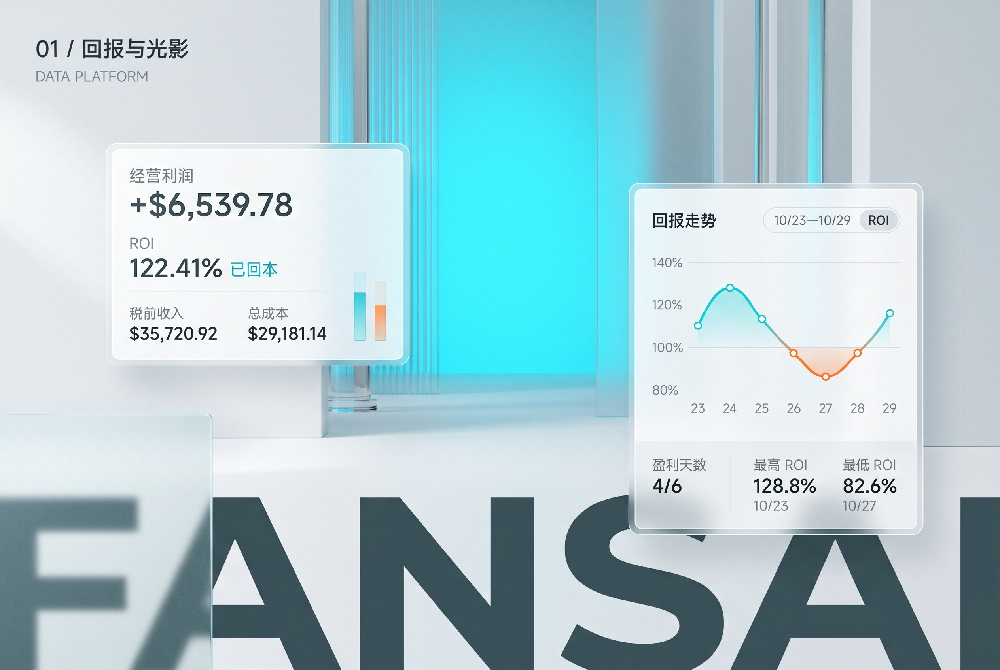
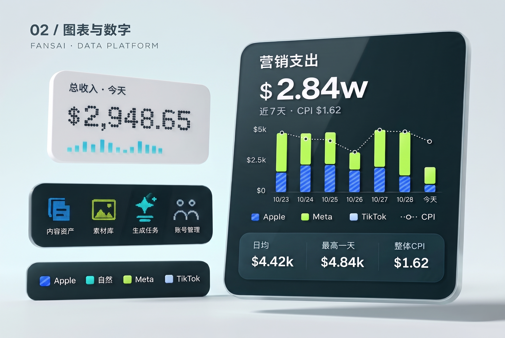
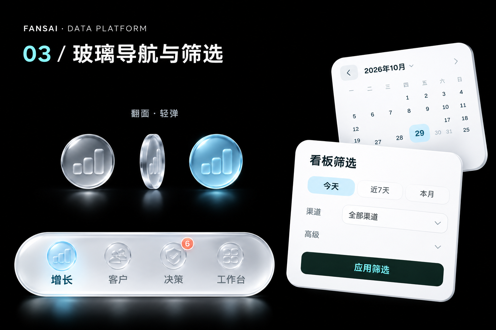

# FansAI Branding V1

青蓝、冰白与深灰青构成的数据图表 HTML 演示，以及本次选定的三张视觉参考图。

[在线预览](https://cocolayuan.github.io/FansAI-Branding-V1/) · [GitHub 仓库](https://github.com/cocolayuan/FansAI-Branding-V1)

## 打开演示

下载本仓库后，直接双击 [index.html](index.html)。无需安装依赖或构建，静态文件可离线运行。

- ROI／经营利润切换；点击或拖动图表查看每日数据，可开启每 5 秒前进的日期轮播。
- 白色自定义日历、日期与渠道筛选，以及渠道图例显隐。
- 浅色页面搭配深色图表，可切换深色模式并记住主题选择。
- 点阵数字、曲线与柱形入场动效；支持键盘操作与系统“减少动态”设置。
- 手机与桌面自适应布局。

数据为离线 Demo，来自既有演示数据；无可用值时显示 `—`。图表按数据计算，统计口径见 [数据说明](data-notes.md)。

这是独立图表演示，不是完整 App。第三张图片用于导航与筛选的风格参考；仓库不包含实际 Rive 动画文件。

## 运行测试

仅测试需要 Node.js 20 或更新版本；打开页面不需要 Node.js。

```bash
# 数据与计算口径
npm test

# 浏览器交互与响应式检查
npm install
npx playwright install chromium
npm run test:browser
```

## 视觉参考

以下三张为本次选定的原图，未重新生成或裁切。效果图用于确认材质、构图与色彩；HTML 采用可交互图形与真实文字排版，不复制 AI 图片中的文字或图表误差。

### 回报与光影



### 图表与数字



### 玻璃导航与筛选



图片来源与版本记录见 [图片说明](docs/image-provenance.md)。
